

  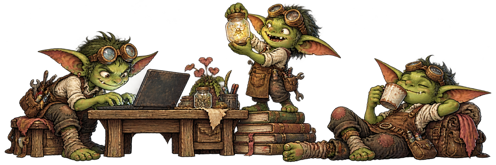

  <a href="https://robaireth.dev"><strong>Website</strong></a> &nbsp;&nbsp;·&nbsp;&nbsp; <a href="https://x.com/0xrobaireth"><strong>X</strong></a> &nbsp;&nbsp;·&nbsp;&nbsp; <a href="https://www.linkedin.com/in/robaireth"><strong>LinkedIn</strong></a>

 

<picture><source media="(prefers-color-scheme: dark)" srcset="assets/stack/rust-dark.svg"></picture> &nbsp; <picture><source media="(prefers-color-scheme: dark)" srcset="assets/stack/typescript-dark.svg"></picture> &nbsp; <picture><source media="(prefers-color-scheme: dark)" srcset="assets/stack/python-dark.svg"></picture> &nbsp; <picture><source media="(prefers-color-scheme: dark)" srcset="assets/stack/react-dark.svg"></picture> &nbsp; <picture><source media="(prefers-color-scheme: dark)" srcset="assets/stack/nextjs-dark.svg"></picture> &nbsp; <picture><source media="(prefers-color-scheme: dark)" srcset="assets/stack/tailwindcss-dark.svg"></picture>
  
<picture><source media="(prefers-color-scheme: dark)" srcset="assets/stack/nodejs-dark.svg"></picture> &nbsp; <picture><source media="(prefers-color-scheme: dark)" srcset="assets/stack/postgresql-dark.svg"></picture> &nbsp; <picture><source media="(prefers-color-scheme: dark)" srcset="assets/stack/docker-dark.svg"></picture> &nbsp; <picture><source media="(prefers-color-scheme: dark)" srcset="assets/stack/cloudflare-dark.svg"></picture> &nbsp; <picture><source media="(prefers-color-scheme: dark)" srcset="assets/stack/fabricjs.png">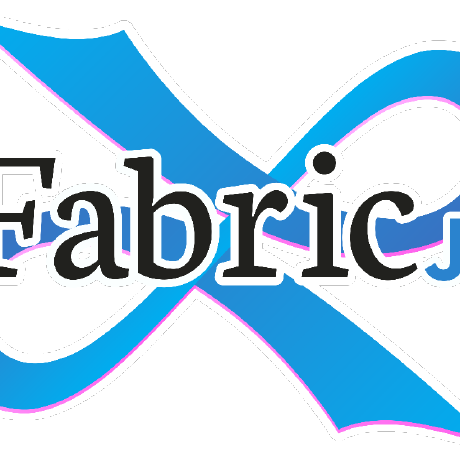</picture> &nbsp; <picture><source media="(prefers-color-scheme: dark)" srcset="assets/stack/swift-dark.svg"></picture>

Full stack · 112

**Languages**

<picture><source media="(prefers-color-scheme: dark)" srcset="assets/stack/rust-dark.svg"></picture> &nbsp; <picture><source media="(prefers-color-scheme: dark)" srcset="assets/stack/typescript-dark.svg"></picture> &nbsp; <picture><source media="(prefers-color-scheme: dark)" srcset="assets/stack/javascript-dark.svg"></picture> &nbsp; <picture><source media="(prefers-color-scheme: dark)" srcset="assets/stack/python-dark.svg"></picture> &nbsp; <picture><source media="(prefers-color-scheme: dark)" srcset="assets/stack/swift-dark.svg"></picture> &nbsp; <picture><source media="(prefers-color-scheme: dark)" srcset="assets/stack/solidity-dark.svg"></picture> &nbsp; <picture><source media="(prefers-color-scheme: dark)" srcset="assets/stack/html5-dark.svg"></picture> &nbsp; <picture><source media="(prefers-color-scheme: dark)" srcset="assets/stack/css3-dark.svg"></picture> &nbsp; <picture><source media="(prefers-color-scheme: dark)" srcset="assets/stack/bash-dark.svg"></picture>

**Web**

<picture><source media="(prefers-color-scheme: dark)" srcset="assets/stack/react-dark.svg"></picture> &nbsp; <picture><source media="(prefers-color-scheme: dark)" srcset="assets/stack/nextjs-dark.svg"></picture> &nbsp; <picture><source media="(prefers-color-scheme: dark)" srcset="assets/stack/astro-dark.svg">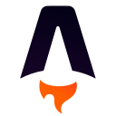</picture> &nbsp; <picture><source media="(prefers-color-scheme: dark)" srcset="assets/stack/vitejs-dark.svg"></picture> &nbsp; <picture><source media="(prefers-color-scheme: dark)" srcset="assets/stack/tailwindcss-dark.svg"></picture> &nbsp; <picture><source media="(prefers-color-scheme: dark)" srcset="assets/stack/shadcnui-dark.svg"></picture> &nbsp; <picture><source media="(prefers-color-scheme: dark)" srcset="assets/stack/radixui-dark.svg"></picture> &nbsp; <picture><source media="(prefers-color-scheme: dark)" srcset="assets/stack/gsap-dark.svg"></picture> &nbsp; <picture><source media="(prefers-color-scheme: dark)" srcset="assets/stack/zustand-dark.svg">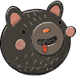</picture> &nbsp; <picture><source media="(prefers-color-scheme: dark)" srcset="assets/stack/reactquery-dark.svg"></picture>

**Graphics & interfaces**

<picture><source media="(prefers-color-scheme: dark)" srcset="assets/stack/angular-dark.svg">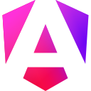</picture> &nbsp; <picture><source media="(prefers-color-scheme: dark)" srcset="assets/stack/vuejs-dark.svg"></picture> &nbsp; <picture><source media="(prefers-color-scheme: dark)" srcset="assets/stack/nuxtjs-dark.svg">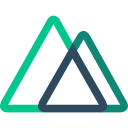</picture> &nbsp; <picture><source media="(prefers-color-scheme: dark)" srcset="assets/stack/solidjs-dark.svg"></picture> &nbsp; <picture><source media="(prefers-color-scheme: dark)" srcset="assets/stack/preact-dark.svg"></picture> &nbsp; <picture><source media="(prefers-color-scheme: dark)" srcset="assets/stack/docusaurus-dark.svg"></picture> &nbsp; <picture><source media="(prefers-color-scheme: dark)" srcset="assets/stack/fabricjs.png"></picture> &nbsp; <picture><source media="(prefers-color-scheme: dark)" srcset="assets/stack/threejs-dark.svg"></picture> &nbsp; <picture><source media="(prefers-color-scheme: dark)" srcset="assets/stack/excalidraw-dark.svg"></picture> &nbsp; <picture><source media="(prefers-color-scheme: dark)" srcset="assets/stack/figma-dark.svg"></picture> &nbsp; <picture><source media="(prefers-color-scheme: dark)" srcset="assets/stack/sharp-dark.svg"></picture> &nbsp; <picture><source media="(prefers-color-scheme: dark)" srcset="assets/stack/ffmpeg-dark.svg"></picture>

**Mobile & backend**

<picture><source media="(prefers-color-scheme: dark)" srcset="assets/stack/reactnative-dark.svg"></picture> &nbsp; <picture><source media="(prefers-color-scheme: dark)" srcset="assets/stack/expo-dark.svg"></picture> &nbsp; <picture><source media="(prefers-color-scheme: dark)" srcset="assets/stack/nodejs-dark.svg"></picture> &nbsp; <picture><source media="(prefers-color-scheme: dark)" srcset="assets/stack/bun-dark.svg"></picture> &nbsp; <picture><source media="(prefers-color-scheme: dark)" srcset="assets/stack/nestjs-dark.svg"></picture> &nbsp; <picture><source media="(prefers-color-scheme: dark)" srcset="assets/stack/express-dark.svg"></picture> &nbsp; <picture><source media="(prefers-color-scheme: dark)" srcset="assets/stack/fastify-dark.svg"></picture> &nbsp; <picture><source media="(prefers-color-scheme: dark)" srcset="assets/stack/hono-dark.svg"></picture> &nbsp; <picture><source media="(prefers-color-scheme: dark)" srcset="assets/stack/axum-dark.svg"></picture> &nbsp; <picture><source media="(prefers-color-scheme: dark)" srcset="assets/stack/tokio-dark.svg"></picture> &nbsp; <picture><source media="(prefers-color-scheme: dark)" srcset="assets/stack/socketio-dark.svg"></picture>

**Android, Python & document data**

<picture><source media="(prefers-color-scheme: dark)" srcset="assets/stack/kotlin-dark.svg"></picture> &nbsp; <picture><source media="(prefers-color-scheme: dark)" srcset="assets/stack/android-dark.svg"></picture> &nbsp; <picture><source media="(prefers-color-scheme: dark)" srcset="assets/stack/jetpackcompose-dark.svg">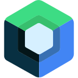</picture> &nbsp; <picture><source media="(prefers-color-scheme: dark)" srcset="assets/stack/gradle-dark.svg"></picture> &nbsp; <picture><source media="(prefers-color-scheme: dark)" srcset="assets/stack/fastapi-dark.svg"></picture> &nbsp; <picture><source media="(prefers-color-scheme: dark)" srcset="assets/stack/pydantic-dark.svg"></picture> &nbsp; <picture><source media="(prefers-color-scheme: dark)" srcset="assets/stack/uvicorn-dark.svg"></picture> &nbsp; <picture><source media="(prefers-color-scheme: dark)" srcset="assets/stack/mongodb-dark.svg"></picture> &nbsp; <picture><source media="(prefers-color-scheme: dark)" srcset="assets/stack/mongoose-dark.svg"></picture> &nbsp; <picture><source media="(prefers-color-scheme: dark)" srcset="assets/stack/firebase-dark.svg"></picture>

**Databases**

<picture><source media="(prefers-color-scheme: dark)" srcset="assets/stack/postgresql-dark.svg"></picture> &nbsp; <picture><source media="(prefers-color-scheme: dark)" srcset="assets/stack/sqlite-dark.svg"></picture> &nbsp; <picture><source media="(prefers-color-scheme: dark)" srcset="assets/stack/redis-dark.svg"></picture> &nbsp; <picture><source media="(prefers-color-scheme: dark)" srcset="assets/stack/prisma-dark.svg">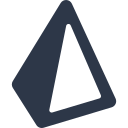</picture> &nbsp; <picture><source media="(prefers-color-scheme: dark)" srcset="assets/stack/drizzle-dark.svg"></picture> &nbsp; <picture><source media="(prefers-color-scheme: dark)" srcset="assets/stack/supabase-dark.svg"></picture> &nbsp; <picture><source media="(prefers-color-scheme: dark)" srcset="assets/stack/neon-dark.svg"></picture>

**Infrastructure**

<picture><source media="(prefers-color-scheme: dark)" srcset="assets/stack/docker-dark.svg"></picture> &nbsp; <picture><source media="(prefers-color-scheme: dark)" srcset="assets/stack/linux-dark.svg"></picture> &nbsp; <picture><source media="(prefers-color-scheme: dark)" srcset="assets/stack/git-dark.svg"></picture> &nbsp; <picture><source media="(prefers-color-scheme: dark)" srcset="assets/stack/githubactions-dark.svg"></picture> &nbsp; <picture><source media="(prefers-color-scheme: dark)" srcset="assets/stack/nginx-dark.svg"></picture> &nbsp; <picture><source media="(prefers-color-scheme: dark)" srcset="assets/stack/amazonwebservices-dark.svg"></picture> &nbsp; <picture><source media="(prefers-color-scheme: dark)" srcset="assets/stack/cloudflare-dark.svg"></picture> &nbsp; <picture><source media="(prefers-color-scheme: dark)" srcset="assets/stack/flydotio-dark.svg"></picture> &nbsp; <picture><source media="(prefers-color-scheme: dark)" srcset="assets/stack/vercel-dark.svg"></picture>

**Services**

<picture><source media="(prefers-color-scheme: dark)" srcset="assets/stack/googlecloud-dark.svg"></picture> &nbsp; <picture><source media="(prefers-color-scheme: dark)" srcset="assets/stack/firestore-dark.svg"></picture> &nbsp; <picture><source media="(prefers-color-scheme: dark)" srcset="assets/stack/azure-dark.svg"></picture> &nbsp; <picture><source media="(prefers-color-scheme: dark)" srcset="assets/stack/stripe-dark.svg"></picture> &nbsp; <picture><source media="(prefers-color-scheme: dark)" srcset="assets/stack/triggerdotdev.png">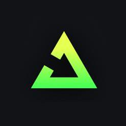</picture> &nbsp; <picture><source media="(prefers-color-scheme: dark)" srcset="assets/stack/posthog-dark.svg"></picture> &nbsp; <picture><source media="(prefers-color-scheme: dark)" srcset="assets/stack/sentry-dark.svg"></picture> &nbsp; <picture><source media="(prefers-color-scheme: dark)" srcset="assets/stack/resend-dark.svg"></picture> &nbsp; <picture><source media="(prefers-color-scheme: dark)" srcset="assets/stack/sequelize-dark.svg">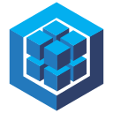</picture>

**Models & orchestration**

<picture><source media="(prefers-color-scheme: dark)" srcset="assets/stack/langchain-dark.svg"></picture> &nbsp; <picture><source media="(prefers-color-scheme: dark)" srcset="assets/stack/langgraph-dark.svg"></picture> &nbsp; <picture><source media="(prefers-color-scheme: dark)" srcset="assets/stack/langsmith-dark.svg"></picture> &nbsp; <picture><source media="(prefers-color-scheme: dark)" srcset="assets/stack/openai-dark.svg"></picture> &nbsp; <picture><source media="(prefers-color-scheme: dark)" srcset="assets/stack/anthropic-dark.svg"></picture> &nbsp; <picture><source media="(prefers-color-scheme: dark)" srcset="assets/stack/googlegemini-dark.svg"></picture> &nbsp; <picture><source media="(prefers-color-scheme: dark)" srcset="assets/stack/groq-dark.svg"></picture> &nbsp; <picture><source media="(prefers-color-scheme: dark)" srcset="assets/stack/fal-dark.svg"></picture> &nbsp; <picture><source media="(prefers-color-scheme: dark)" srcset="assets/stack/replicate-dark.svg"></picture>

**Data science**

<picture><source media="(prefers-color-scheme: dark)" srcset="assets/stack/numpy-dark.svg"></picture> &nbsp; <picture><source media="(prefers-color-scheme: dark)" srcset="assets/stack/pandas-dark.svg"></picture> &nbsp; <picture><source media="(prefers-color-scheme: dark)" srcset="assets/stack/scipy-dark.svg"></picture> &nbsp; <picture><source media="(prefers-color-scheme: dark)" srcset="assets/stack/scikitlearn-dark.svg"></picture> &nbsp; <picture><source media="(prefers-color-scheme: dark)" srcset="assets/stack/catboost-dark.svg"></picture> &nbsp; <picture><source media="(prefers-color-scheme: dark)" srcset="assets/stack/xgboost-dark.svg"></picture> &nbsp; <picture><source media="(prefers-color-scheme: dark)" srcset="assets/stack/lightgbm-dark.svg"></picture> &nbsp; <picture><source media="(prefers-color-scheme: dark)" srcset="assets/stack/matplotlib-dark.svg"></picture> &nbsp; <picture><source media="(prefers-color-scheme: dark)" srcset="assets/stack/jupyter-dark.svg"></picture>

**Blockchain**

<picture><source media="(prefers-color-scheme: dark)" srcset="assets/stack/nervos.png">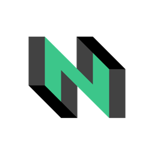</picture> &nbsp; <picture><source media="(prefers-color-scheme: dark)" srcset="assets/stack/ccc-dark.svg"></picture> &nbsp; <picture><source media="(prefers-color-scheme: dark)" srcset="assets/stack/monad.png">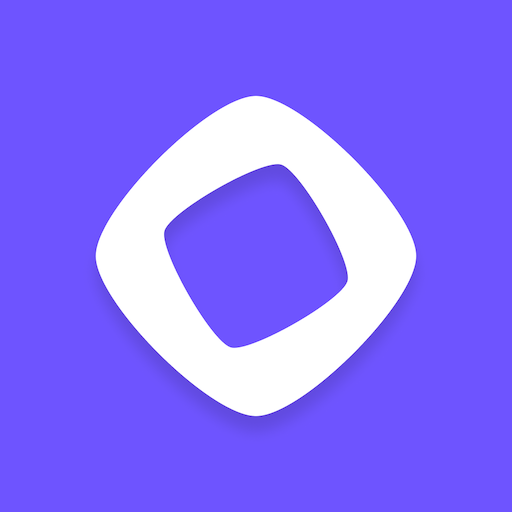</picture> &nbsp; <picture><source media="(prefers-color-scheme: dark)" srcset="assets/stack/solana.png">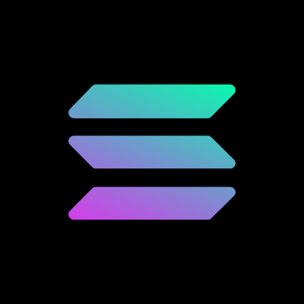</picture> &nbsp; <picture><source media="(prefers-color-scheme: dark)" srcset="assets/stack/ethereum-dark.svg"></picture> &nbsp; <picture><source media="(prefers-color-scheme: dark)" srcset="assets/stack/circleusdc.png"></picture> &nbsp; <picture><source media="(prefers-color-scheme: dark)" srcset="assets/stack/ethers-dark.svg"></picture> &nbsp; <picture><source media="(prefers-color-scheme: dark)" srcset="assets/stack/fiber-dark.svg"></picture>

**Testing & quality**

<picture><source media="(prefers-color-scheme: dark)" srcset="assets/stack/playwright-dark.svg"></picture> &nbsp; <picture><source media="(prefers-color-scheme: dark)" srcset="assets/stack/vitest-dark.svg"></picture> &nbsp; <picture><source media="(prefers-color-scheme: dark)" srcset="assets/stack/jest-dark.svg"></picture> &nbsp; <picture><source media="(prefers-color-scheme: dark)" srcset="assets/stack/eslint-dark.svg">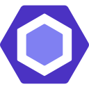</picture> &nbsp; <picture><source media="(prefers-color-scheme: dark)" srcset="assets/stack/prettier-dark.svg"></picture> &nbsp; <picture><source media="(prefers-color-scheme: dark)" srcset="assets/stack/biome-dark.svg">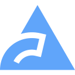</picture> &nbsp; <picture><source media="(prefers-color-scheme: dark)" srcset="assets/stack/zod-dark.svg"></picture> &nbsp; <picture><source media="(prefers-color-scheme: dark)" srcset="assets/stack/pytest-dark.svg"></picture> &nbsp; <picture><source media="(prefers-color-scheme: dark)" srcset="assets/stack/ruff-dark.svg"></picture>

<picture>
  <source media="(prefers-color-scheme: dark)" srcset="https://raw.githubusercontent.com/robaireth/robaireth/chore/profile-stats/assets/streak-dark.svg">
  
</picture>

